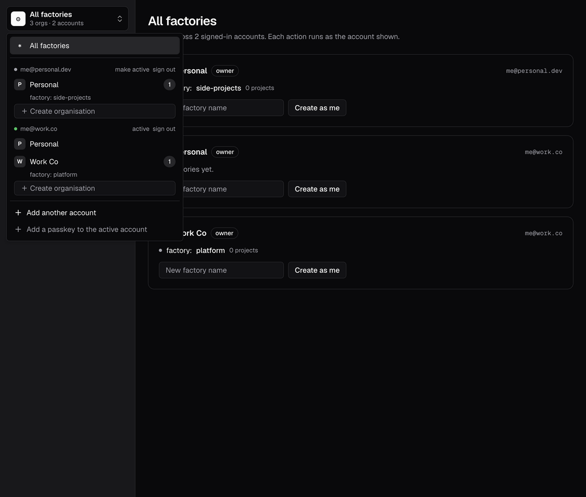

# Spike: Better Auth orgs + multi-account

**Question:** can one browser be signed in to a personal account and a work account at once, see
every org across both in one "All factories" view, and have every action run as the right
account, on Workers + D1?

**Answer: yes.** Better Auth 1.7.16 (the CRM's version) with the `organization`, `multi-session`
and `passkey` plugins runs on D1 as-is. The cross-account view and per-account actions need about
150 lines of our own code (`src/server/accounts.ts`, `src/server/api.ts`). The proposed decision
refines the accepted [ADR 0024](../../docs/adr/0024-identity-orgs-and-multi-session.md) and is in [`docs/adr-0120-auth-orgs-and-multiple-accounts.md`](docs/adr-0120-auth-orgs-and-multiple-accounts.md).



## What's here

| Path | What |
|---|---|
| `src/server/auth.ts` | `createAuth(env)`: Better Auth on D1, organization (with `factory`/`project` permissions), multi-session (max 5), passkey, GitHub, email+password behind a flag. Personal org creation. |
| `src/server/accounts.ts` | `listDeviceAccounts` and `accountSession`: every account signed in on this device, and headers that act as exactly one of them. |
| `src/server/api.ts` | `/api/factory/*`: `GET /orgs` (all orgs across accounts, each tagged with its account), `POST /orgs`, `POST /factories`, `POST /switch`, `POST /sign-out-account`. |
| `src/routes/index.tsx` | The UI: "All factories" switcher (accounts → orgs → factories), add another account, make active, sign one account out, create org/factory as a named account, add a passkey. |
| `migrations/` | `0001` is Better Auth's schema, generated by `getMigrations()`; `0002` is the factory/project stubs. |
| `test/multi-account.test.ts` | 15 tests in workerd against a real local D1. |

Hierarchy: **user → org (member + role) → factory → project**. Factory and project are stub tables.

## Run it

```sh
pnpm install --ignore-workspace   # spikes/ is not a workspace member
cp .dev.vars.example .dev.vars   # set BETTER_AUTH_SECRET (openssl rand -hex 32)
pnpm db:migrate:local
pnpm dev                         # http://localhost:5173
pnpm test && pnpm lint && pnpm typecheck
```

GitHub sign-in needs a GitHub OAuth app (callback `http://localhost:5173/api/auth/callback/github`)
in `.dev.vars`. Without one, use the email + password form (on via `AUTH_EMAIL_PASSWORD=true` in
`wrangler.jsonc`, for local dev only).

## How it works

The multi-session plugin keeps one signed, httpOnly cookie per account
(`better-auth.session_token_multi-<token>` = `<token>.<signature>`) next to the normal session
cookie, which points at the *active* account.

- **Listing:** `listDeviceSessions` checks each `_multi-` cookie's signature and session row. For
  each account we build an **account session**: a `Headers` with only that account's signed
  token as the session cookie. Every Better Auth call made with it (`listOrganizations`,
  `hasPermission`, `createOrganization`) runs as that account and no other. The results are
  merged and each org is tagged with `accountUserId`.
- **Acting:** every write names `accountUserId`. The server finds that account among *this
  request's* verified device sessions (401 if it isn't signed in here), then asks Better Auth's
  `hasPermission` for that org under that account session (403 if not a member or role too low).
  It never falls back to the active session.
- Session tokens never reach the browser from our API; the client only ever sees user ids.

## Verified (tests in `test/multi-account.test.ts`)

- The committed migrations match the Better Auth config exactly (`getMigrations` has nothing to do).
- Every new user gets a Personal org they own. It's idempotent and self-heals if missing.
  Clients can't create an org with the reserved `personal-` slug.
- `GET /orgs` lists both accounts' orgs, each tagged with its account; active flag correct; no
  session tokens in the response; empty for a signed-out browser.
- **Wrong account:** with personal and work both signed in, creating a factory in Work Co as the
  personal account gets **403** and writes nothing, whether work or personal is active.
- The right account works even when another account is active.
- An account not signed in on this device gets **401**. A forged `_multi-` cookie (right name,
  bad signature) gets **401**.
- Switching changes only the active account; each session keeps its own active org.
- Signing one account out leaves the other signed in and active.
- The 6th account signs in and becomes active but is silently not kept as a device session.

Also checked by hand in Orca's browser against `vite dev` + local D1: sign in, "Add another
account", the switcher (screenshot above), create factories as each account, "make active".

**Not verified:** GitHub sign-in (needs an OAuth app; code path is config only) and passkey
registration/sign-in (needs a real authenticator, so it wasn't exercised in tests or by hand).
Nothing was deployed to Cloudflare; everything ran locally in workerd.

## Findings and gotchas

### Multi-session plugin
1. **The Better Auth client only acts on the active session.** `authClient.organization.*`,
   `passkey.addPasskey()` and so on all use the active cookie. For a cross-account UI, don't
   call them directly for an item: either switch first, or (as here) call our own endpoint that
   names the account. Adding a passkey goes to whichever account is active.
2. **No per-account API out of the box.** Better Auth has no "call this endpoint as session X".
   The trick is to rebuild a cookie header from the `_multi-` cookie's signed value. It relies on
   the cookie format (`<name>_multi-<token lowercased>`), so pin the version and keep the test.
3. **`maximumSessions` overflow is silent.** Past the limit (default 5), the new sign-in still
   succeeds and becomes active, but gets no `_multi-` cookie, so it disappears from the account
   list once you switch away. The UI should block "Add another account" at the limit.
4. **Signing in again as an account that's already signed in** replaces its old device session;
   it doesn't add a duplicate. `listDeviceSessions` also de-duplicates by user.
5. **`listDeviceSessions` and sign-in responses return raw session tokens to JavaScript.** They
   aren't usable without the signature (no bearer plugin), but keep it that way: don't add the
   `bearer` plugin without rethinking this. Our API returns user ids only.
6. **`/sign-out` signs out every account** on the device (the plugin's after hook). Use
   `multi-session/revoke` to sign out one.
7. **GitHub reuses the browser's GitHub login**, so "Add another account" can sign the same
   person in again. We pass `prompt: "select_account"`, and account linking is off so a work and
   a personal GitHub account never merge by email.

### Organization plugin
8. **`activeOrganizationId` lives on the session**, so each account has its own active org. That
   suits multi-account, but the "All factories" view shouldn't depend on it: every action passes
   `organizationId` explicitly.
9. **A non-member gets 401, not 403** from `hasPermission` (`USER_IS_NOT_A_MEMBER_OF_THE_ORGANIZATION`).
   That collides with "not signed in", so we map refusals after session verification to 403.
10. **`createOrganization` with no session but a `userId` is a "system action"** (server only).
    Safe here because we always pass a session's headers; just never forward a client `userId`.
11. **Custom permissions work well:** `factory`/`project` statements sit next to the org
    plugin's own, and `hasPermission` checks both. This is the seam for the factory's gate.
12. `createOrganization` sets the new org active on the calling session unless you pass
    `keepCurrentActiveOrganization: true`.

### D1
13. **D1 works when passed straight in** (`database: env.DB`), as in the CRM. But the D1 dialect
    **has no interactive transactions**, so the user insert and the Personal org insert can't
    share one. We write the org + owner membership in one D1 `batch()` (atomic), with
    deterministic ids and `INSERT OR IGNORE`, run it from the user `create.after` hook, and
    re-run it when listing orgs (self-healing).
14. **Dates are ISO-8601 text** in D1 (`date` columns). Raw SQL that writes Better Auth tables
    must match that, not `Date.now()`.
15. **Generate the schema, don't hand-write it.** `getMigrations(auth.options).compileMigrations()`
    gives the exact SQL; a test asserts the committed migrations still match, which catches a
    plugin upgrade adding columns.
16. Better Auth's default table names (`user`, `session`, `organization`…) are camelCase-columned.
    The CRM renames them to `core_*` with snake_case fields; the factory should decide its naming
    once, before the first real migration.
17. `organizationHooks.beforeCreateOrganization` can't tell a system call from a user call, so
    reserving `personal-` slugs works only because Personal orgs bypass the API (raw batch).

### Stack
18. The vitest setup is the CRM's (`@cloudflare/vitest-plugin`, D1 + `readD1Migrations`), copied
    standalone because `spikes/` is outside the workspace. A plain `pnpm install` here resolves to
    the repo root's workspace instead, so use `--ignore-workspace`.

## Open questions

- **Account limit:** keep Better Auth's 5, and hide "Add another account" at the limit?
- **Personal org kind:** stored as an org `kind` column (`personal`/`team`, not settable by
  clients). Should a Personal org be invite-able, or always single-member?
- **Table naming:** Better Auth defaults (here) or the CRM's `core_*` + snake_case?
- **Email + password:** dev-only here. Does production need any non-GitHub, non-passkey sign-in
  (e.g. for a domain expert without GitHub, like the patientos doctor)?
- **Runner ownership** (users own runners, share them into orgs) is out of scope here; it sits on
  the same user/org ids.
